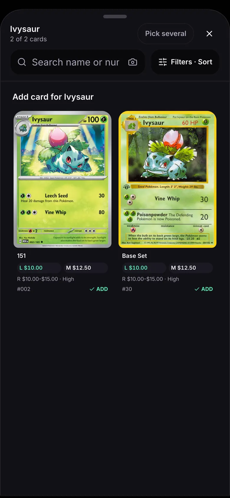
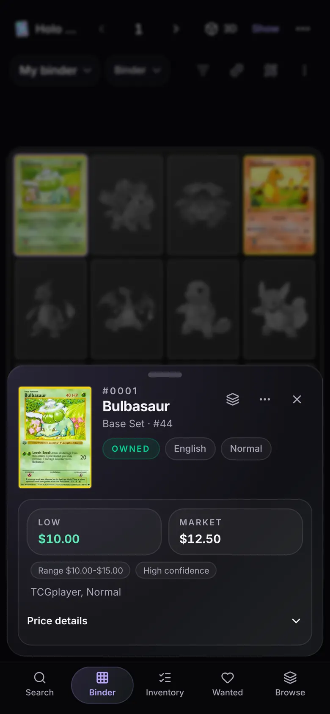

Adding a card is a matter of tapping the pocket it belongs in and picking the printing in your hand. Holo Folder saves the set, language and finish, so your binder shows the exact card you own rather than just the Pokémon.

## Add a card to a pocket

1. Open your binder with **Binder** in the dock and find the right page.
2. Tap an empty pocket. A Pokémon's pocket lists that Pokémon's cards, and a free pocket lets you search every card, including Trainers and Energy.
3. Narrow the list with the search box (a name, set or card number all work), or tap **Filters · Sort** to filter by set, rarity, variant and **Card language**.
4. Tap the card you own. If that printing comes in more than one finish, Holo Folder asks **Which variant?** so you can pick normal, holo, reverse holo and so on. The most likely one is marked **Likely**.

The card goes straight into the pocket and the picker closes back onto your binder.

### Several cards at once

When you're filling a page, tap **Pick several** in the picker. Tap each card you want, or tap **Pick all** to pick every card your search and filters show, up to 100 at a time. Then tap **Add N cards**. They fill the empty pockets on that page first, in order. If you pick more than fit, the rest go onto the following pages: a custom binder adds new pages at the end, while a set or Dex binder only uses empty pockets it already has and tells you when there's no room left.

### Pockets kept for one card

If a pocket is kept for one exact card, such as in a set binder, tapping it shows that card's details straight away. Tap **Got it** to add exactly that card in one go, or **Choose a copy** to pick a different printing.

## The card details sheet

Tap a pocket with a card in it to open its details. You'll see the card's picture (tap it to zoom), its name, set and number, and chips for **Owned**, its language and its finish. If the card comes in more than one finish, tap the right one to change it.

Further down are the card's price when one is known, any **Wanted upgrade** you've noted for that pocket, and the card's illustrator. Tap the illustrator to see all their cards. **All cards** at the top shows every printing of that Pokémon.

## Take a card out or remove it

Open the card's details and tap **More card options** (the **⋯** button). You have two choices, and they're different:

- **Take out of this pocket** empties the pocket, but the card stays in your collection as a spare. Use this when you're moving it somewhere else.
- **Remove from collection** is for a card you no longer own. It deletes the card itself and empties its pocket. Holo Folder asks you to confirm with **Remove card** because it can't be undone with one tap.

You can also press and hold (or right-click) a pocket for a shortcut menu with **View card**, **Take the card out** and **Remove from collection**.

## Move cards and pockets

Pockets keep their cards when they move. Press and hold a pocket and choose **Move this pocket**, then tap where it should go. To move or tidy several pockets together, tap **⋮** beside the binder name and choose **Edit layout**, select the pockets, and use **Move**, **Add**, **Fill** or **Remove**. Tap **Done** when you're finished.

### Park cards in the tray

While you're editing the layout, a parking tray sits just above the bottom bar. Drag a card onto it to park it, then turn pages as much as you like: parked cards wait in the tray. When you've found the spot, drag the stack out of the tray onto a pocket, and every parked card lands together just before it. You can also tap the tray and then tap the pocket. **Undo move** puts them back if you change your mind.

Parked cards stay where they are in your binder until you place them, so nothing is saved until then. Tapping a pocket while editing parks it too. If you tap **Done** with cards still in the tray, they're just unparked and nothing moves.

### Drag a card out

While you drag a card, a **Take out** zone opens next to the tray. Drop the card there to empty its pocket. The card stays in your collection, and **Undo** on the message that appears puts it back in the same pocket, as long as nothing has gone there since. Graded cards don't offer the zone; take them out from the card's options instead.

If you made a mistake, you can undo recent changes from your collection's history. See [history and settings](/help/history-and-settings).

## Related

- Point your camera at a card instead of searching in [Scan cards](/help/scanning).
- Note cards you're still after in [your want list](/help/want-list).
- See what your cards are worth in [Prices](/help/prices).
