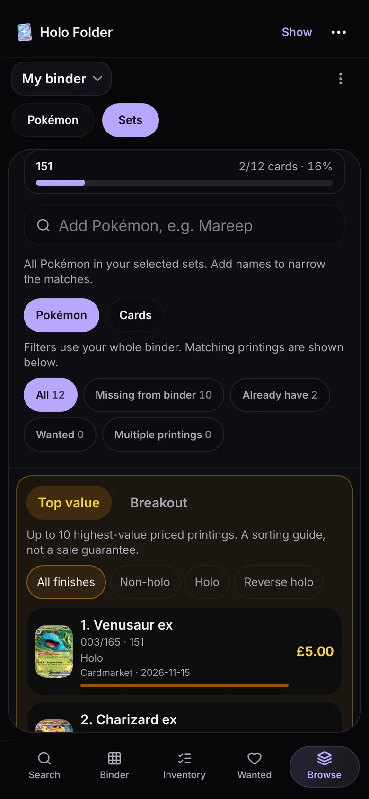
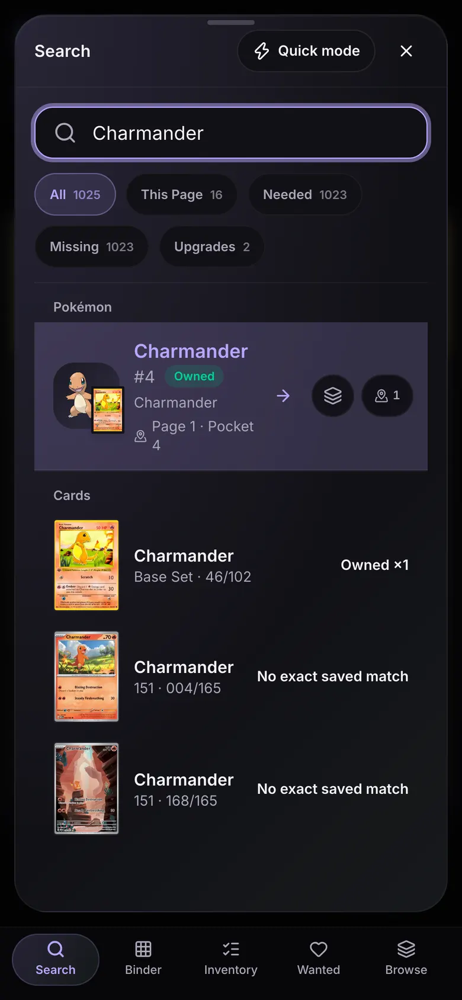

Holo Folder isn't only for the cards you own. You can look through every Pokémon and every set in our catalogue, check a set off card by card, and find all the cards an illustrator has drawn. Most of this works without an account, too.

## Browse sets and Pokémon

Tap **Browse** in the dock. Two buttons at the top switch between **Pokémon** and **Sets**, and **Browse** goes back to whichever you used last.

**Sets** lists every set, grouped by series. Find one with the search box (a name, set code or year all work) or narrow the list by series, then tap a set to open it. You'll see how much of it you've completed and its checklist. The checklist can show the set's **Pokémon** or every one of its **Cards**, and you can filter it by name, number or rarity. Cards you have in your binder are marked **Owned**, and cards on your want list are marked **Wanted**.

You can open more than one set at a time by searching for another one, which helps when you're comparing a main set with its subsets.

**Pokémon** is a grid of every Pokémon. Search by name or National Dex number and tap one to see all of its cards. From any card you can open its details, choose a finish, add it to your binder or put it on [your want list](/help/want-list).

## The National Dex list

For a quick look down the whole National Dex, open the **More** menu at the top of the screen and choose **National Dex**. It lists every Pokémon in Dex order with whether you own it, and the search box finds a Pokémon by name, card, set or Dex number.

## Search for anything

Tap **Search** in the dock to search everything at once. Type a Pokémon, a card name, a set, an illustrator or a Dex number, and results are grouped into Pokémon, sets, illustrators and cards. You can combine a Pokémon and a set, such as "Abra 151", to find one card quickly.

- Tapping a **Pokémon** takes you to its pocket in your binder, or shows all its cards if the binder has no pocket for it.
- Tapping a **set** opens that set in **Sets**.
- Tapping an **illustrator** shows every card they've drawn.
- Tapping a **card** opens its details.

When the search box is empty, your recent searches are listed so you can jump back to them. Pressing and holding **Search** opens Quick mode instead, a faster one-handed search that's handy at card shows. See [Show mode](/help/show-mode).

Offline, search only finds cards already saved on your device, and Sets shows the set details you've opened before. See [Install and use offline](/help/offline-and-install).

## Without an account

You can try Holo Folder before signing up. Without an account you can browse the National Dex and every set, search for any card, open card details and see prices, and use Show mode to check what a card is worth.

Anything that would change a collection, such as adding a card or putting one on a want list, asks you to create an account first. Nothing is saved on your device until you do. When you're ready, tap **Join now** at the top, then follow [Make your first binder](/help/getting-started).

## Related

- [Add your cards](/help/adding-cards) once you've found what you own.
- Find a card by pointing your camera at it in [Scan cards](/help/scanning).
- See what a card is worth in [Prices](/help/prices).
