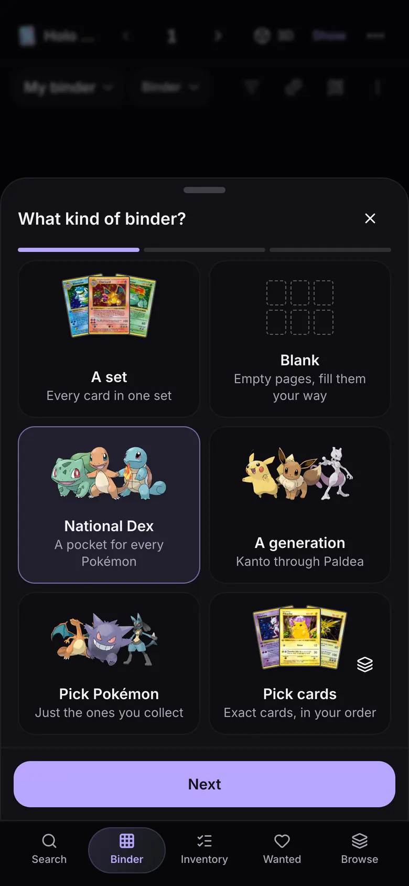
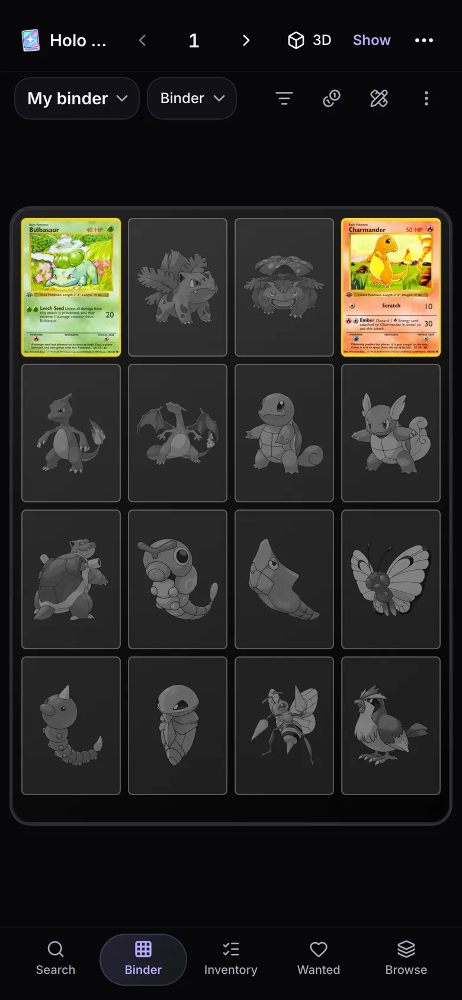

Holo Folder works like the binder on your shelf. You choose what the binder is for, it lays out pages of pockets for you, and you fill those pockets as you collect. This guide takes you from a new account to your first page.

## Create an account

You can look around without an account, but you need one to save cards. Tap **Join now** at the top of the screen. Trying to add a card while signed out also opens the same sign-up window.

You have two ways in:

1. **Email**: type your address and tap **Continue with email**. We send you a secure link, and opening it signs you in. There is no password to remember.
2. **Password**: choose a password of at least 8 characters and tap **Create password account**. We may email you a link to confirm your account first.

Your collection is tied to your account, so it syncs across every device you sign in on.

## Set up your first binder

The first time you sign in with nothing set up, Holo Folder opens **Set up your first binder** by itself. If you would rather look around first, tap **Skip for now**. You can start the same wizard later from the binder name at the top of the screen (choose **New binder** at the bottom of the list) or from the **⋮** menu beside it. You need to be online to create a binder.

The wizard asks a few short questions, skipping any that don't apply. You can go back at any point and your choices are kept.

1. **What kind of binder?** Pick one of six starting points:
   - **A set**: every card in one set, in set order.
   - **Blank**: empty pages to fill your way.
   - **National Dex**: a pocket for every Pokémon.
   - **A generation**: one region's Pokémon, from Kanto through Paldea.
   - **Pick Pokémon**: just the Pokémon you collect, in the order you choose them.
   - **Pick cards**: exact cards, in your order. Trainers and Energy can go in too.
2. **Which set, generation, Pokémon or cards?** Search for and tap your choices.
3. For a set, you also choose **Which versions?** to fill. **One of each card** means any version fills the pocket, or you can give normal, holo and reverse holo prints their own pockets. Some sets also offer the promos released alongside them.
4. **Name and pages**: give the binder a name, then choose how it **Looks like**. **Binder pages** shows a grid, and **A simple list** suits a box, tin or shelf. You can switch between the two later. Pick how many **Pockets on a page** (4, 9, 12 or 16), or **Custom** for your own size up to 8 by 8 with Holo Folder Premium. A blank binder also asks **How many pages?**
5. **Preview** shows your first pages. Tap **Create binder** and it opens as soon as it's saved to your account.

Creating a binder never adds cards to your collection. It only lays out the pockets, ready for you to fill.

## How pages and pockets work

Each pocket in your binder is kept for something. It might be for a Pokémon (any of its cards will do), for one exact card, or a free pocket that takes any card. A pocket holds one card, and the binder fills in its picture once you add it.

Move between pages with the arrows at the top, or type a page number in the box between them. The view button next to the binder name switches between **Binder** pages and a **List** of the same pockets.

The dock along the bottom takes you everywhere else: **Search**, **Binder**, **Inventory**, **Wanted** and **Browse**.

## What next

- [Add your cards](/help/adding-cards) to fill your first pockets.
- Keep track of cards you're hunting with [your want list](/help/want-list).
- Make more than one binder with [multiple binders](/help/multiple-binders).
- Look through every set and Pokémon in [Browse cards and sets](/help/browsing-cards).
