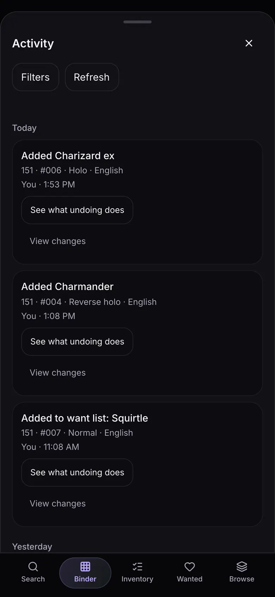
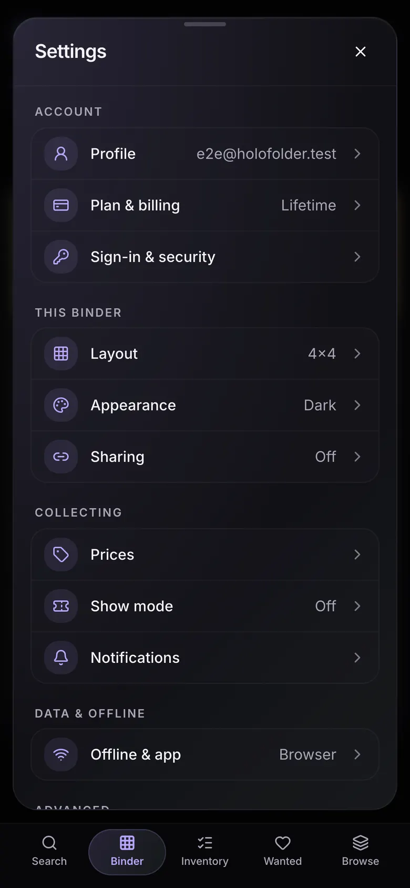

Holo Folder keeps a record of every change made to your collection, so if a card goes missing or a page looks wrong you can see exactly what happened and, in most cases, put it back.

## See your history

Tap your binder's name at the top of the screen to open **Binders**, then tap **Activity**. You can also open it from the **Activity** button on a card's details, which shows only the changes to that card.

Changes are grouped by day, newest first. Each one says what happened, such as "Removed a card", who did it and when. Tap **View changes** to see the details, and **Older page** at the bottom to go further back.

To narrow things down, tap **Filters**. You can pick a collection, a person (handy if you [collect with a partner](/help/partners)), a date range, and the kind of change: **Cards and wanted lists**, **Collections and settings** or **Older recorded changes**. Tap **Apply filters** to see the results, and **Refresh** to load anything new.

## Undo a change

1. Find the change in **Activity**.
2. Tap **See what undoing does**. Holo Folder shows you exactly what will change before anything happens.
3. If it looks right, tap **Undo this change**, or **Not now** to leave it.

If undoing would bring back cards that have since been removed, you can choose which binder they go back into. Once it's done you'll see "Undone. Your collection is up to date."

Some changes say "This change can't be undone from here", and if the preview says "This change can no longer be undone", it can't be reversed any more. You need to be online to undo, with your latest edits already saved. If you've made changes offline, Activity shows how many are waiting to sync and Undo becomes available once they're saved.

## Settings

Open **More** (the three dots at the top right), then **Settings**. Tap a row to open it.

**Account**

- **Profile**: your **Name**, used in notifications to your partner, and your **Username**, used in [named share links](/help/sharing).
- **Plan & billing**: your plan.
- **Sign-in & security**: tap **Add a passkey** so you can use **Sign in with a passkey** next time instead of waiting for an email, or remove one you no longer use.

**This binder**

- **Layout**: how many rows and columns each page has, plus a link to **Binder Studio**.
- **Appearance**: **Page colours** for the whole binder or a run of pages, **Dark mode**, and the shine effects (**Binder slot glare**, **Motion glint** and **Card finish glints**). **Slot positions** shows A1, B4 and so on in each pocket, on this device only.
- **Sharing**: your read-only link and binder address. See [Share a binder](/help/sharing).

**Collecting**

- **Prices**: under **Region & pricing**, choose your **Region**, the **Currency** prices are shown in and the **Card language** new cards default to. Each starts on Automatic, based on your device. **Refresh prices in background** rechecks prices for every card in the binder. More in [Prices](/help/prices).
- **Show mode**: turn [Show mode](/help/show-mode) on or off, and set the **Deal checker** thresholds for **Great deal**, **Fair price** and **Walk away**. **Reset** puts them back to the defaults.
- **Notifications**: alerts for partner activity and finished price checks, set up per device.

**Data & offline**

- **Offline & app**: install Holo Folder, save whole sets for offline use, and download this binder with **Prepare this binder**. See [Install and use offline](/help/offline-and-install).
- **Backup**: **Download backup** saves this binder's owned cards, wanted cards and settings, including any edits not yet synced, as a file.

**About**

- **Credits & attributions** lists where our card data, images and set symbols come from. Card images are © The Pokémon Company, Nintendo, Creatures and GAME FREAK.

## Sign out

Tap **More**, then **Sign out**. The same menu has a quick **Dark mode** or **Light mode** switch too.

## Related

- [Troubleshooting](/help/troubleshooting) if changes aren't syncing.
- [More than one binder](/help/multiple-binders) for renaming, reordering and deleting binders.
