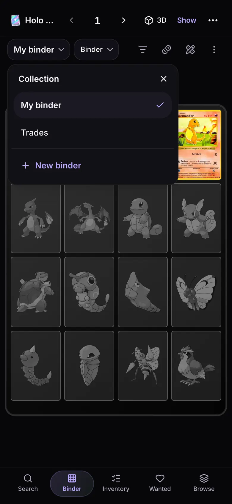
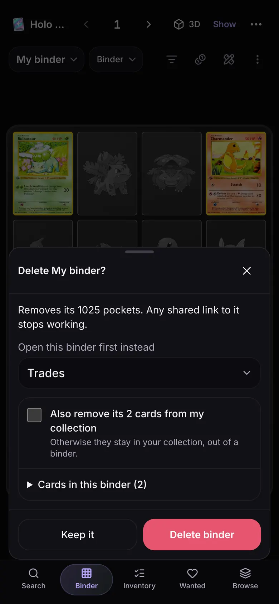

Many collectors keep more than one binder: a National Dex, a set they're completing, a binder of favourite illustrators. Holo Folder lets you keep each of these as its own named binder, with its own pages, pockets and wanted cards, all in one account.

## Make another binder

1. Tap the binder name at the top of the screen. It opens a list of your binders.
2. Tap **New binder** at the bottom of the list.
3. Follow the wizard to choose what the binder is for, its name and its page size, then tap **Create binder**.

You'll find **New binder** in the **⋮** menu beside the binder name too. Both open the same wizard, which is explained step by step in [Make your first binder](/help/getting-started).

You need to be online to create a binder, with your latest changes saved. If you've just made some changes, the option says it will be available once they've saved. The free plan includes up to four binders, and Holo Folder Premium lets you make more. If you go back to the free plan with more than four, you keep all of them but can't add another.

## Switch between binders

Tap the binder name at the top and pick another binder from the list. The one you have open has a tick next to it. Holo Folder remembers the binder you last opened on each device and opens that one next time.

Each binder keeps its own view and page, so switching away and back puts you where you were. The button next to the binder name switches the open binder between **Binder** pages and a **List**.

## Your cards across binders

Every binder has its own pockets, and your want list covers all of them. Each wanted card shows which binder, page and pocket it belongs to, so you always know where a new card should go. When you add a card to your want list, it goes on a pocket in the binder you have open. See [Your want list](/help/want-list).

If you collect with a partner, they share every one of your binders automatically. See [Collect with a partner](/help/partners).

## Binder addresses

Each binder has its own web address, so you can bookmark it or come straight back to a page. The address ends with a short name for the binder followed by the page, like `/app/national/binder/3`. A new binder gets its short name from what it's for (such as `national`, a region or the set) or else from its name.

You can choose your own short name. Open the binder, then **⋮** and **Sharing**, and edit **Binder slug** under **Binder address**. It can be 1 to 60 letters, numbers or hyphens, starting and ending with a letter or number. The same name is used for the binder's named share link, so changing it means the old named link stops working. Find out more in [Share a binder](/help/sharing).

## Delete a binder

1. Open the binder you want to delete.
2. Tap **⋮** beside the binder name and choose **Delete this binder**.
3. Holo Folder shows how many pockets and wanted cards will go. Read it carefully, then tap **Delete binder**.

Deleting a binder removes its pockets and its wanted cards, and any shared link to it stops working. Your cards aren't deleted unless you ask: they stay in your collection, out of a binder, so you can put them in another binder later. If you'd rather remove them too, tick **Also remove its cards from my collection** (it shows how many) and the button changes to **Delete all**. Graded cards always stay in your collection. Expand **Cards in this binder** to see exactly which cards are affected before you decide.

If you're deleting the binder that opens first, Holo Folder asks which binder should open first instead. Tap **Keep it** if you change your mind.

## Related

- Undo a change you didn't mean to make in [History and settings](/help/history-and-settings).
- Send someone a read-only link to one binder in [Share a binder](/help/sharing).
