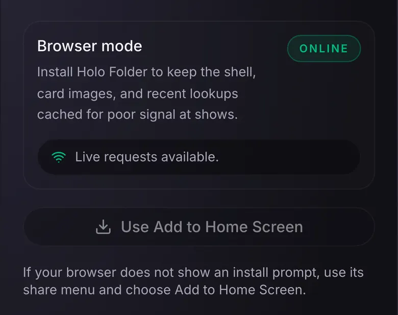

Holo Folder runs in your phone's browser, but it works best installed on your home screen. It then opens like any other app, full screen, and keeps what it needs on your phone so your binder opens even when a card show hall has no signal.

## Install on iPhone

1. Open Safari and go to holofolder.com/app. Sign in if you haven't already.
2. Tap the share button at the bottom of the screen.
3. Scroll down and tap **Add to Home Screen**, then **Add**.

Holo Folder now has its own icon. Open it from there rather than from Safari to get the full app experience.

## Install on Android

1. Open Chrome and go to holofolder.com/app.
2. Tap **More** in the Holo Folder header and choose **Install app**, then confirm.

If **Install app** isn't in the menu, your browser hasn't offered installation yet. Use the browser's own menu and choose **Add to Home Screen** or **Install app** instead.

You can also install from **Settings** under **Offline & app**, which has an **Install Holo Folder** button whenever your browser supports it, and tells you whether you're using the installed app or the browser.

## What works offline

Once you've opened Holo Folder online at least once while signed in, it keeps a copy of your collection on your phone. With no signal, or on Wi-Fi that connects but goes nowhere, the app opens straight into your binder from that copy instead of hanging on a loading screen.

Offline you can:

- Open and page through your binders, and open card details you've seen before.
- Search your own cards, plus any sets you've saved for offline.
- Use [Show mode](/help/show-mode), including the Hunting list and the deal checker, which uses the last price saved on your phone and tells you how old it is.
- Scan cards, as described in [Scanning](/help/scanning).
- Keep adding, moving and removing cards.

Things that need a live connection, such as fresh prices, cards you've never looked at, and signing in, wait until you're back online. When Show mode is on, the header shows **Offline · using saved cards and prices** so you know where the numbers are coming from.

## Get ready before a show

If you know you'll be somewhere with poor signal, spend a minute on Wi-Fi beforehand. Open **Settings** from the **More** menu and go to **Offline & app**.

Under **Offline sets**, search by **Set name or code**, tick the sets you want and tap **Check download size**. You'll see how many card images it involves and roughly how much space it needs. Tap **Download for offline** to save their checklists, card images and last-known prices, so you can browse and search those sets with no connection.

**Prepare this binder** does the same for every owned and wanted card in the binder you have open, including images and saved prices. Tap **Download binder** to start, and **Verify saved data** later to check everything is still there. If a download is interrupted, **Resume / retry download** picks up where it left off without starting again.

While you're there, turn on **Download scanner for offline** so the scanner can recognise cards by their picture without a connection.

## Changes you make offline

Anything you change offline is saved on your phone straight away and sent to your account as soon as you're back online. You don't need to do anything to make that happen, and you can keep working while it catches up. Your edits are queued in the order you made them and aren't thrown away if the app is closed in the meantime.

If you share a collection with a [partner](/help/partners), they'll see your offline changes once your phone has synced. If you want a copy of everything, including changes that haven't synced yet, **Download backup** in **Settings** saves one (see [History and settings](/help/history-and-settings)).

Offline storage belongs to your account. Browsing without signing in doesn't save anything to your phone, so sign in before you head out if you want your binder to be there. If something doesn't look right after reconnecting, see [Troubleshooting](/help/troubleshooting).
