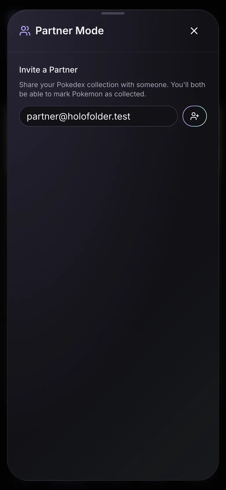

Partner Mode is for people who build one collection together, like a couple, a parent and child, or two friends pooling their cards. Unlike a [share link](/help/sharing), which only lets people look, a partner can make changes, and they get every binder in the collection rather than just one.

## How it works

When you invite someone and they accept, you both work on **your** collection: the person who sent the invite is the owner, and the collection, binders and settings are theirs. Your partner sees all of your binders, can mark cards as owned, add to the want list and edit pages, exactly as you can. Every change is recorded in [your history](/help/history-and-settings) with the name of whoever made it.

You can have one partner at a time.

## Invite a partner

You both need a Holo Folder account. Your partner can sign up before or after you send the invite, as long as they use the email address you invite.

1. Tap **More** (the three dots at the top right), then **Partner**.
2. Under **Invite a Partner**, type their email address.
3. Tap the invite button next to the box.

The invite then shows under **Pending Invites** with "Waiting..." beside it until they answer.

Inviting a partner is part of Premium. If your account isn't on Premium, the invite button takes you to upgrade instead of sending the invite.

## Accept an invite

If someone has invited you, sign in with the email address they used, then tap **More** → **Partner**. Their invite appears under **Received Invites**, showing who it's from. Tap the tick to accept, or the cross to turn it down.

Once you accept, Holo Folder opens your partner's collection. Your own binders aren't deleted, they're just set aside while you're partnered, and you'll be back to them if you disconnect.

## Once you're connected

Open **More** → **Partner** at any time to see who you're partnered with under **Currently partnered with**.

If you'd like a heads-up when your partner adds a card, go to **More** → **Settings** → **Notifications** and tap **Enable on this device**. You'll get an alert when your partner adds an owned card or marks a wanted card as got, and when your price checks finish. Notifications are set up separately on each phone or tablet. On an iPhone or iPad, add Holo Folder to your Home Screen first and enable them inside the installed app (see [Install and use offline](/help/offline-and-install)).

One thing stays with the owner: only they can change a binder's named address for sharing.

## Disconnect

Either of you can end the partnership. Tap **More** → **Partner**, then **Remove partner**. The owner keeps the collection and everything in it. The other person goes back to their own collection, and can no longer see or change the owner's binders.

If you want to partner up again later, just send a fresh invite.

## Related

- [Share a binder](/help/sharing) if you only want people to look, not edit.
- [History and settings](/help/history-and-settings) to see who changed what and undo a change.
- [More than one binder](/help/multiple-binders) for organising the binders you share.
