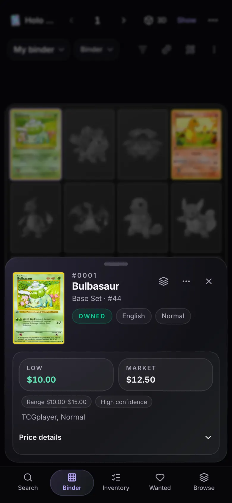
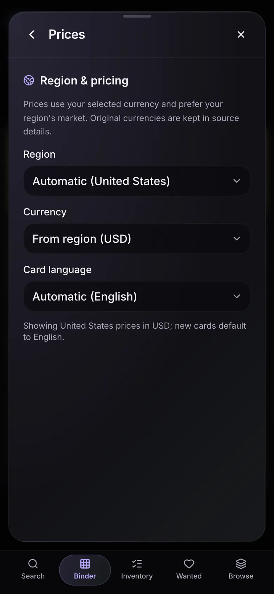

Holo Folder shows a price where it has trustworthy data and nothing where it doesn't. We'd rather leave a gap than show a number we can't stand behind.

## Where prices come from

Prices are gathered from card marketplaces and price trackers, including TCGplayer, Cardmarket and PokePulse. Holo Folder combines them into a single picture for each printing and finish, so a holo and a reverse holo of the same card each get their own price.

Open any card in your binder to see its **Prices**. **Market** is the typical going rate, and **Low** is a good price to buy at, never higher than market. Underneath you'll see the range, how confident the price is, and which source it came from. Tap **Price details** to see each source's figures side by side.

## Currency and region

Prices are shown in the currency you choose and lean towards your region's market. To change them, open **Settings** from the **More** menu and go to **Prices**. Under **Region & pricing** you can set:

- **Region**: United Kingdom, European Union, United States or Japan, or automatic based on your phone's settings.
- **Currency**: GBP, EUR, USD or JPY, or the currency that matches your region.
- **Card language**: the language new cards default to.

When a source quotes a price in another currency, Holo Folder converts it using published exchange rates and keeps the original amount in the price details. If there's no exchange rate to use, it shows no price rather than guessing one.

## What confidence means

Every price carries a label saying **High confidence**, **Medium confidence** or **Low confidence**. It tells you how much the data behind the number agrees with itself.

A price is high confidence when a source gives both a market price and a lower figure to go with it. With only a market price, it's medium. Confidence drops when the sources disagree a lot with each other, and it also drops as data gets old: after a week without an update a price can be no better than medium, and after a month it's low.

Low confidence prices are still shown on the card for reference, but Holo Folder won't build anything on them. Rising, Breakout and deal verdicts in [Show mode](/help/show-mode) only ever use high or medium confidence prices.

## Why a card has no price

You'll see **No price** when there isn't a usable figure for that card. The most common reasons are:

- None of the sources has data for that printing yet, which is common for brand new or very obscure cards.
- The price is in a currency we can't convert, or a source reported zero, which we treat as missing.
- The card has a finish, such as reverse holo, that hasn't been priced separately. We don't borrow the normal version's price for it.

If you're offline, Holo Folder shows the last price saved on your phone and says how old it is. A card you've never opened before may have no saved price until you're back online.

## Rising and Breakout

**Rising** marks a card whose price is climbing. It appears when a card's current price is at least 10% above its average over the last week, or at least 15% above its average over the last month, comparing figures from the same source. To avoid false alarms, it ignores cards under £1 (where one sale can swing the price wildly), data more than a week old, and moves so big they're more likely an error. You'll see Rising in card lists, in Quick mode results and in the deal checker.

**Breakout** ranks the printings of a Pokémon or a set with the strongest recent climb, up to ten at a time. A rise over a week counts for more than the same rise over a month. You'll find it at the top of a Pokémon's full card list (open a card and tap the all-cards button next to the Pokémon's name), and on a set in **Sets**, where you can switch between **Top value** and **Breakout**. If nothing is rising confidently, Breakout is hidden. Breakout is part of Holo Folder Premium.

## Refreshing prices

Holo Folder refreshes prices automatically in the background, in passes every few hours, so there's nothing you need to tap.

For getting prices onto your phone before a show with poor signal, see [Offline and installing the app](/help/offline-and-install).
