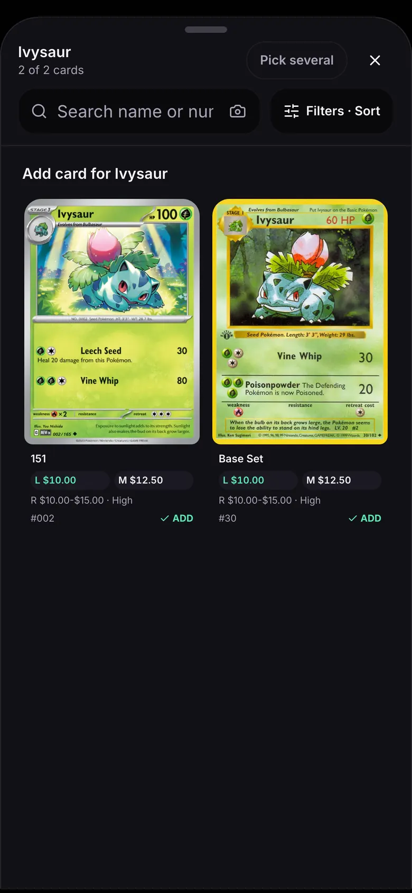
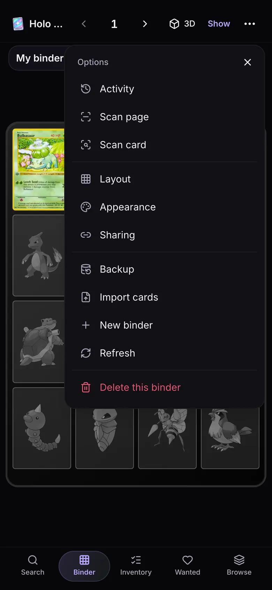
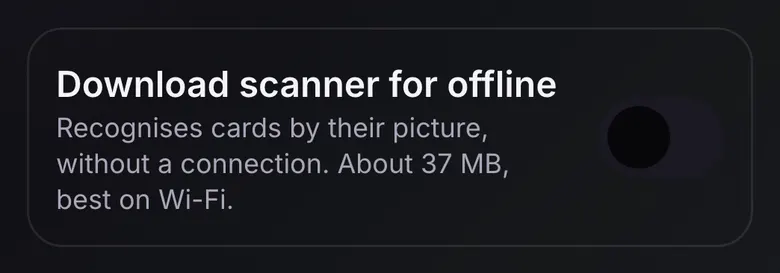

Scanning saves you typing card names and numbers. Holo Folder looks at the card through your camera, works out which printing it is, and then lets you confirm before anything changes in your binder. There are a few places to scan from, depending on what you're doing.

## Scan a card into a pocket

When you're filling a particular pocket, scan from the card picker so the result lands in the right place.

1. Open your binder and tap an empty pocket. The card picker opens.
2. Tap **Scan card**. If you're choosing a wanted card rather than one you own, the button reads **Scan wanted**.
3. Place the card inside the guide on screen and keep it steady, then tap **Start Guided Scan**. The scanner takes several frames in a row and shows how many were usable.
4. The best matches appear in the picker. Tap the right printing to add it.

## Scan from the Storage menu

You can also scan without choosing a pocket first. In your binder, open the **Storage** menu (the ⋮ button) and tap **Scan card**.

Fill the frame with one card so its name and number are in view, then tap **Read card**. If you already have a photo of the card, tap **Photo** to use that instead, and if the camera isn't playing along, **Type instead** lets you search by hand.

Holo Folder then shows what it found. If it isn't sure, it asks **Which card is this?** and offers the closest matches to pick from. You can also choose where the card goes with **Put it in**, either a particular pocket or **A new pocket at the end**. Nothing is added until you tap **Add 1 card**.

## Scan a whole binder page

**Scan page**, also in the **Storage** menu, reads every pocket on a page at once, which is handy when you're bringing an existing binder into the app.

Lay the page flat and fit all of its pockets in view, then tap **Take photo**, or **Choose photo** to use one you've already taken. Holo Folder reads each card, leaves pockets that already hold a card as they are, and shows you the results under **Choose each card, then add them to your binder.** You confirm every card before it's added, so a misread never ends up in your collection without you seeing it.

Scanning single cards and whole pages are both included in the free plan.

## Scan at a card show

With Show mode on, Quick mode has its own **Scan** button next to the search field. Point it at a card on a dealer's table and tap **Read card**. When there's one clear match, Holo Folder opens the deal checker for that card straight away so you can type the asking price. When there isn't, it types what it read into the search and tells you, for example asking you to pick the right printing from the results. See [Show mode](/help/show-mode) for the rest of the card show tools.

## Scanning with no signal

Scanning still works offline, with one difference. Out of the box, an offline scan reads the card's name and number and matches them against the cards already saved on your phone, so a card you've never looked at before may not be found.

To recognise cards by their picture without a connection, download the scanner ahead of time:

1. Open **Settings** from the **More** menu and go to **Offline & app**.
2. Turn on **Download scanner for offline**. It shows the download size first, and it's best done on Wi-Fi.

Once it's downloaded, the scanner recognises cards from their artwork on the device itself. You can turn the switch off again to free up the space. There's more on preparing for shows with poor signal in [Offline and installing the app](/help/offline-and-install).

## Tips for a good read

The scanner does best when the card fills the frame and nothing else is in shot. Make sure the name and the collector number at the bottom are both visible, as those are what it reads when it can't match the picture. Hold the phone steady until the read finishes.

Good light matters more than anything else. Where your phone supports them, the camera view has a light button and a zoom control. If a read still fails, try a photo instead or search by hand. [Troubleshooting](/help/troubleshooting) has more to try, and [Adding cards](/help/adding-cards) covers the other ways in.
