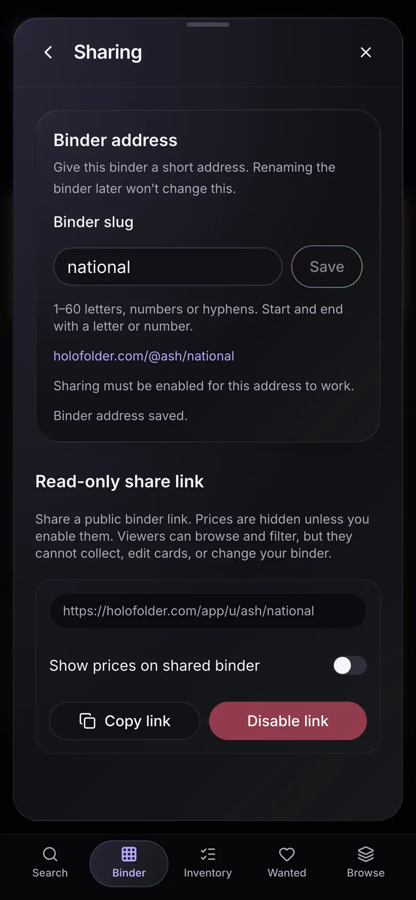

Every binder can have its own read-only link. Anyone with the link can look through that binder in their browser without signing up, but they can't change anything. Links are per binder, so you can share your National Dex binder with a friend and keep your trade binder to yourself.

## Make a share link

The quickest way is from the binder itself.

1. Open the binder you want to share.
2. Tap **More** (the three dots at the top right).
3. Tap **Create share link**. You'll see "Read-only share link is live".
4. Open **More** again and tap **Copy share link**, then paste it wherever you like.

Once a link is live, the menu always offers **Copy share link** for that binder, so you can grab it again any time.

You can also manage everything from **More** → **Settings** → **Sharing**. If the binder has no link yet, tap **Generate read-only share link**. When it's on, you'll see the full address, a **Copy link** button and the other options below.

## What viewers can and can't see

People who open your link can browse your pages and filter the binder, and tap a card to see its details. They can't collect cards, edit cards or change your binder in any way, and your activity history isn't shown on shared binders.

Prices are hidden by default. If you'd like viewers to see what your cards are worth, switch on **Show prices on shared binder** on the Sharing page. Switch it off again and prices disappear from the shared view.

## Give your binder a named address

A standard share link ends in a long random code. If you'd rather send something memorable, like `holofolder.com/@ashcollects/national`, you can give the binder a named address. It's made of two parts: your username and the binder's own short name.

**Choose a username first.** Go to **Settings** → **Profile**, type a name in **Username** and tap **Save username**. Usernames are 3 to 30 letters, numbers or hyphens, starting and ending with a letter or number, and each one can only belong to one person.

**Then name the binder.** Go to **Settings** → **Sharing**, and under **Binder address** type a short name in **Binder slug** and tap **Save**. You'll see "Binder address saved." and the full address underneath. Renaming the binder later won't change its address.

A few things worth knowing:

- Sharing must be switched on for the named address to work.
- Changing your username stops your previous named links working, and changing a binder's slug breaks that binder's previous named link. Your old names stay reserved to you, so nobody else can pick them up.
- Only the binder's owner can change its address. If you collect with a partner, they'll see the address but can't edit it.

## Turn sharing off

Go to **Settings** → **Sharing** and tap **Disable link**. You'll see "Read-only share link disabled", and anyone who tries the link afterwards won't be able to open your binder.

If you change your mind, tap **Generate read-only share link** on the same page. The binder gets its old link back, so anything you've already sent will work again.

## Related

- [More than one binder](/help/multiple-binders) explains how each binder keeps its own settings.
- [Collect with a partner](/help/partners) is for sharing your whole collection with someone who can edit it too.
- [Prices](/help/prices) covers where the prices on a shared binder come from.
