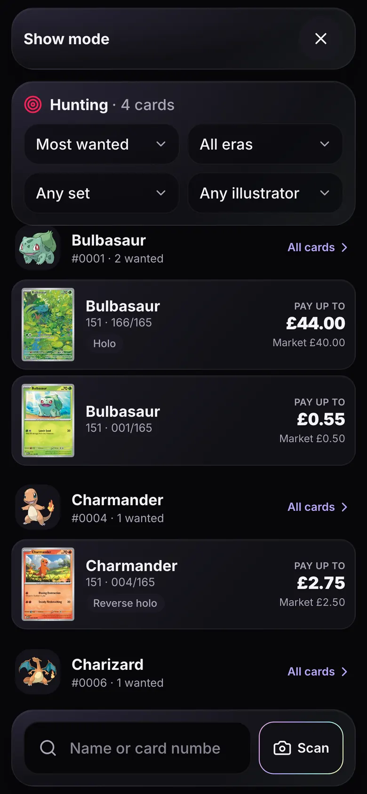
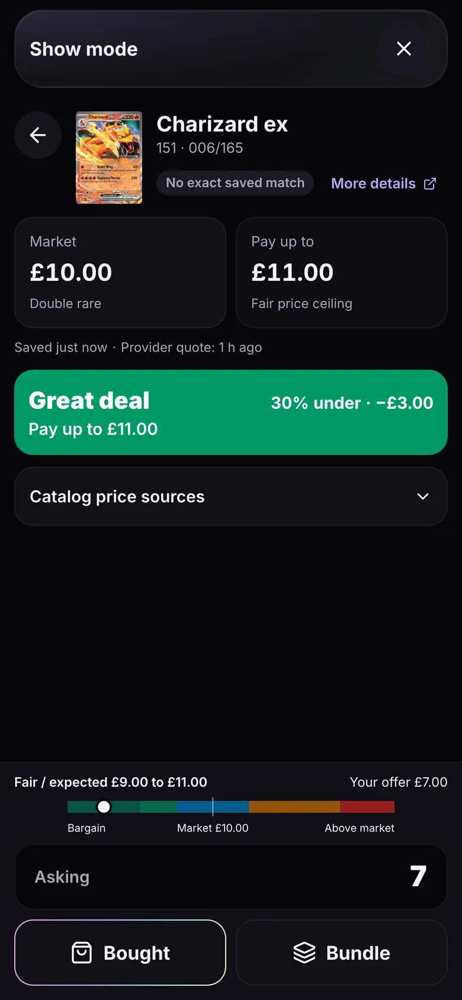

Show mode turns Holo Folder into a one-handed tool for card shows. Search opens straight into Quick mode, tapping a card checks an asking price, and your screen stays on while you browse.

## Turn Show mode on and off

Tap **Show** in the header, which appears on every main view once you're signed in and have cards in your collection, or use the **Show mode** switch in **Settings**. The header turns amber while it's on. Tap **Exit** to leave. If you leave it on and come back hours later, it switches itself off. The setting is saved on this phone only.

## Open Quick mode

With Show mode on, tapping **Search** in the dock opens Quick mode, which keeps the search field near your thumb. Outside Show mode you can press and hold **Search**, tap **Quick mode** on the Search sheet, or press Ctrl+K (Cmd+K on a Mac).

## The Hunting list

Quick mode opens on **Hunting**, your want list grouped by Pokémon. Each card shows what to pay up to, and one tap opens the deal checker. Use **Sort** to put the most wanted, highest value, or biggest price drops and rises first, and filter by era, set or illustrator to match how a dealer's binder is laid out. **Good pickups** collects wanted cards whose price has recently dropped.

The list is built from the collection saved on your phone, so it works with no signal. If your want list is empty, see [Your want list](/help/want-list).

## Check a deal

Search for any card, or tap one on the Hunting list, and Holo Folder shows its market price with the **Asking price** field ready to type in. Enter what the dealer wants and you get a verdict:

- **Great deal**: 20% or more under market.
- **Good price**: more than 10% under market.
- **Fair price**: within 10% either side of market.
- **Overpriced**: more than 10% over market.
- **Walk away**: 35% or more over market.

The verdict shows how far the asking price is from market and the most you'd pay for it to still count as fair. If a card has several variants, switch to the right one first. When there isn't a confident market price, Holo Folder gives no verdict rather than guessing. Offline, it uses the price saved on your phone and tells you how old it is. See [Prices](/help/prices) for where prices come from.

To come back to a card later, add a **Stall or condition note** and tap **Save for later**. It appears under **Revisit deals** on this phone.

## Bundles

When a dealer offers several cards for one price, tap **Add to bundle** on each card's check. Then open **Bundle** from Quick mode, type the **Bundle price**, and Holo Folder compares it with the cards' combined market price. **Check bundle prices** looks up recent sold and listed prices for each card in the bundle.

## Change the deal thresholds

The percentages above are defaults. In **Settings**, open **Show mode** and find **Deal checker**, where you can change **Great deal**, **Fair price** and **Walk away**. **Reset** puts them back. Thresholds are saved on this phone.

## Price check any card

You don't need Show mode to check a price. On the Wanted view, search your want list and tap **Check price of any card** (or **Not here? Check price of any card** below the results). Quick mode opens as **Price check** with the same deal checker for any card.

## Your purchase tally

Once you've typed the asking price, tap **Bought**. Holo Folder adds the card to your collection, into the pocket that wanted it or otherwise your inventory, and adds what you paid to this show's tally. A message confirms where it went, with **Undo**. For a bundle, **Bought bundle** adds every card and splits the total across them by market price. All of this works offline and syncs when you're back online.

The header shows how many cards you've bought and what you've spent. To keep yourself in check, tap **Set show budget** in Quick mode, enter a **Spending limit** and tap **Save budget**, and Holo Folder shows what's left or how far over you are.

The tally is saved to your account, so a [partner](/help/partners) sharing your collection sees the same purchases. It starts again after a day. **Clear** under **This show** in the Show mode settings resets it on this phone only.

Deal verdicts, pay-up-to prices and the purchase tally are part of Holo Folder Premium. On the free plan you'll see **Unlock deal checks** in their place.
