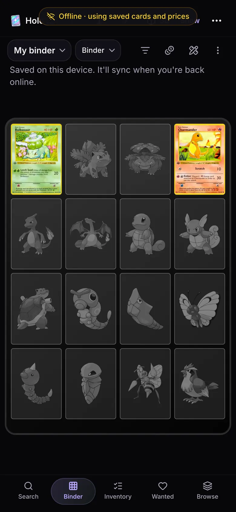

Most hiccups in Holo Folder come down to signal or to a card we don't have full details for yet. Here's what each one looks like and what to do about it.

## Changes haven't synced yet

Holo Folder saves every edit on your device first and sends it on when it can, so nothing is lost if your signal drops. When an edit is still waiting, you'll see a short note at the top of your collection:

- **"Saved on this device. It'll sync when you're back online."** You're offline. Carry on as normal and your changes will go through once you reconnect.
- **"Couldn't save your latest change yet. Trying again…"** Holo Folder is retrying by itself. Tap **Try now** if you don't want to wait.
- **"Your collection changed somewhere else, so your latest change is on hold. Nothing is lost."** Someone else, or you on another device, changed the collection at the same time. Tap **Try again**.
- **"Syncing is paused. Your change is saved on this device. Check you're signed in to the right account."** Check the account under **More** → **Settings** → **Profile**, then tap **Try again**.
- **"This change couldn't be saved. Discard it, then make it again."** Tap **Discard** and redo the edit.

While changes are waiting, [Activity](/help/history-and-settings) shows how many there are, and Undo becomes available once they've been saved.

## Card images are missing

If a card shows a plain **No image** tile, we don't have a picture for that printing yet. The card itself is still in your collection and everything else about it works as normal.

If images were showing before but are blank now, you're probably offline and those pictures haven't been saved to your device. To keep a whole binder's images to hand, go to **Settings** → **Offline & app** and tap **Download binder** under **Prepare this binder** while you have a good connection. See [Install and use offline](/help/offline-and-install).

## I can't find a card in search

Search looks for Pokémon names, card names, sets, illustrators and Dex numbers. If you see "No matches", try fewer words, or a Pokémon name with a set, like **Abra 151**.

If you're offline, you'll see "No matches in your saved cards" instead. Offline, search only covers cards already saved on your device, so try again once you're connected, or save the sets you need beforehand under **Settings** → **Offline & app** → **Offline sets**.

You can also open the set in **Browse** ([Browse cards and sets](/help/browsing-cards)) or [scan the card](/help/scanning).

## A card has no price

"No price yet" means we don't have a market price for that card that we're confident in. We'd rather show nothing than a guess. In Show mode the deal checker says "No market price for this card yet, so no verdict" for the same reason.

A few other cases:

- **Offline**, you'll only see prices already saved on your device, and cards without one say so.
- **On a shared binder**, prices only appear if the owner has switched on **Show prices on shared binder**.
- **To update your binder's prices**, go to **Settings** → **Prices** and tap **Refresh prices in background**.

[Prices](/help/prices) explains where our prices come from.

## Signing in on a new phone

Sign in with the same email address you used before and your binders will load. Tap **More** → **Sign in**, then either:

- choose **Email**, enter your address and tap **Continue with email**, then open the link we send you;
- choose **Password** and sign in, or tap **Email me a reset link** if you've forgotten it; or
- tap **Sign in with a passkey**, if you've added one under **Settings** → **Sign-in & security**.

You'll need a connection the first time. If you open Holo Folder offline on a phone where you've never signed in, it will tell you nothing is saved on this device yet. If you collect with a partner, you'll see the shared collection as soon as you sign in.
