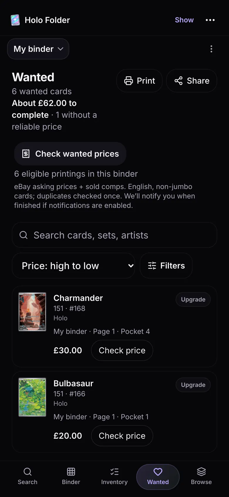

Your want list is every card you're still looking for, down to the set, language and finish. Each wanted card belongs to a pocket in one of your binders, so when you finally find it, Holo Folder already knows where it goes.

## Add a card to your want list

You add a want from a card's details, which you can open from almost anywhere: a search result, a set checklist in **Browse**, or **All cards** on a pocket in your binder.

1. Open the card you're after and pick the finish you want, if it comes in more than one.
2. Tap **Add to want list**. You'll see "Added to your want list" when it's saved.

The want goes on a pocket in the binder you have open. If you opened the card from a pocket, it goes on that pocket. Otherwise Holo Folder uses the pocket kept for that exact card, or failing that, the pocket for that Pokémon. If the open binder has no pocket for the card, the button is greyed out and Holo Folder says so. Open a binder that has a pocket for it, then try again.

A pocket that already holds a card can still have a want. This is how you note an upgrade, such as a holo you'd like in place of the reverse holo you have. In the binder, that pocket's details show it under **Wanted upgrade**, and an empty pocket's details show **Wanted here**.

## See your want list

Tap **Wanted** in the dock. The list shows how many cards you want and, when we have reliable prices for them, roughly what it would cost to complete. Cards without a reliable price are counted separately rather than guessed. Each card shows its set and number, its finish, its price (or **No price**) and which binder, page and pocket it's for. Wants for a pocket that already holds a card are tagged **Upgrade**.

To find a card quickly, use **Search want list**, which matches cards, sets and artists. The sort menu offers orders such as **Price: high to low**, **Cheapest set to finish first**, **Recently added**, **Rising prices first** and **Group by Pokémon**, and the filters button narrows the list by price, set, finish and language. Holo Folder remembers your sort and filters on this device.

**Print** gives you a printable sheet of your wanted cards. **Share**, part of Holo Folder Premium, sends the list as it's currently searched, filtered and sorted. On a phone it opens your share sheet, so you can send it in a message, and elsewhere it copies the list for you to paste.

## Tick off a card you've found

When a wanted card turns up, add it to your binder. You can do this straight from the want list: open the **Choose a copy** menu on that card and pick **New copy**, or one of your spare copies (listed as **Unassigned copy**), then tap **Add to collection**. It goes into the pocket the want belongs to. You can also go to the pocket in your binder and add the card there in the usual way. See [Add your cards](/help/adding-cards).

## Remove a card from your want list

Tap **Check price** on the card in your want list to open its details, then tap **Remove from want list**. You can do the same from the card's details wherever you open it.

## Related

- At a card show, Show mode turns your want list into a quick **Hunting** list. See [Show mode](/help/show-mode).
- Find out where prices come from, and why some cards have none, in [Prices](/help/prices).
- Browse sets and Pokémon to find cards to want in [Browse cards and sets](/help/browsing-cards).
