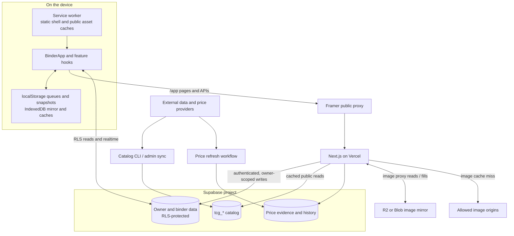
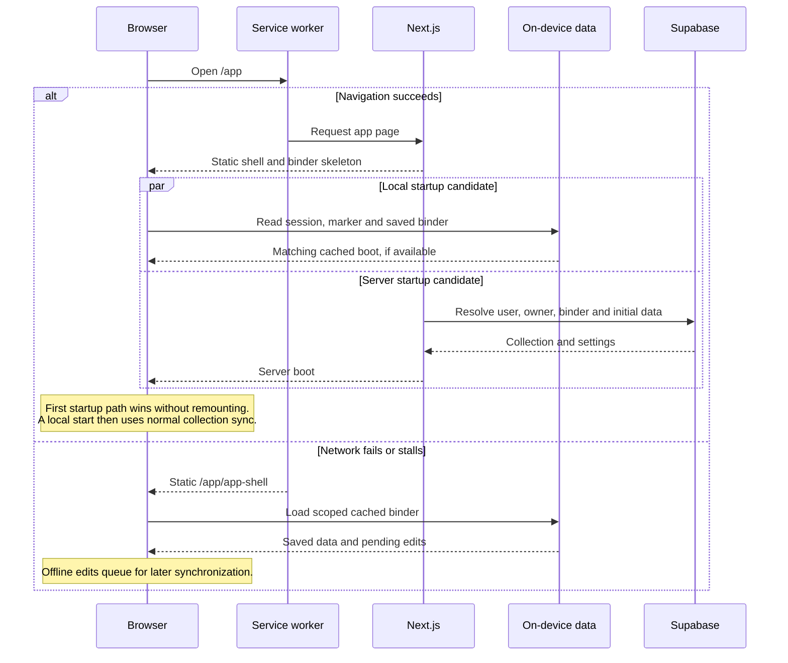
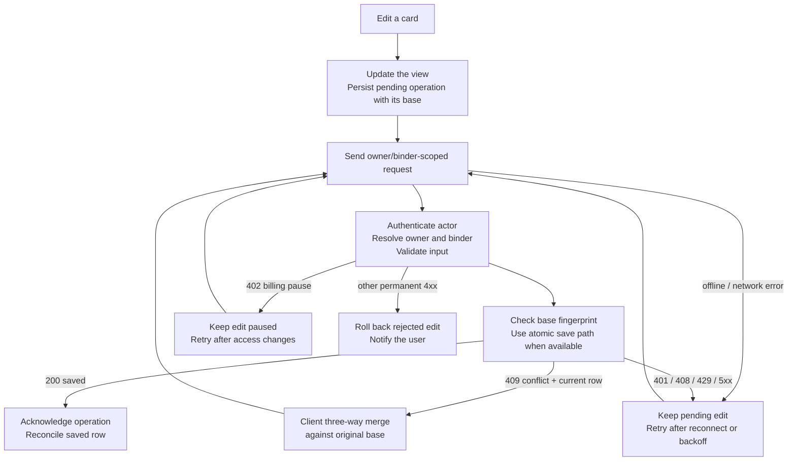

# Architecture

Holo Folder is a Next.js application with a browser-owned offline working copy and a Supabase-backed shared collection. It is deployed under `/app`; the separate Framer site forwards public app requests to the Vercel origin. See [app-routing.md](app-routing.md) before changing URLs.

## System overview

The browser keeps its working copy on the device. Personal data and public catalog/price data have separate authorization and caching rules, even though they live in the same Supabase project.

Service-role/provider credentials stay on the server. On-device data is scoped to the account, collection owner and binder. The service worker caches the static offline shell, not personalized HTML.

## Ownership and authorization

Three identifiers have different jobs:

| Identifier         | Meaning                                       | Source of authority                                                         |
| ------------------ | --------------------------------------------- | --------------------------------------------------------------------------- |
| Authenticated user | The person making the request                 | Supabase session/JWT; write routes validate the user                        |
| Collection owner   | The account whose binders/settings are shared | `lib/server/collection-owner.ts`, partnership membership and billing access |
| Binder             | One collection within an owner's account      | `lib/server/binders.ts`, `lib/binders/` and owner-scoped queries            |

An owner and an allowed partner share the owner's binders. Billing access is per owner. Public share links expose only an enabled read-only binder; they do not establish collection membership. Migration 053 makes read-only sharing free; partner access remains an entitlement decision. See [billing.md](billing.md) and [multiple-binders.md](multiple-binders.md).

User-scoped Supabase reads rely on row-level security. Routes that use the service-role client bypass RLS, so they must authenticate the actor, resolve allowed ownership/binder membership and normalize input before reading or writing. Never trust a browser-supplied owner ID. Keep `lib/supabase/admin.ts` server-only; shared modules load it dynamically.

## Startup and state

`app/page.tsx` starts the asynchronous server bootstrap without waiting at the page's top level. `components/binder-start.tsx` renders through Suspense and can show this device's matching saved binder before the server response arrives. `lib/binder-start.ts` scopes the saved startup snapshot to the account, owner and binder. The active binder comes from the requested binder, last-opened cookie or owner's default.

`components/binder-app.tsx` coordinates views, overlays, selection, binder navigation and device modes. Feature hooks own their synchronization lifecycles; pure transforms and validation belong in `lib/`. Switching binders remounts the app with the new scope. Settings belong to the collection owner; individual binders can override their grid/appearance.

The static offline route (`app/app-shell/`, `components/offline-app-shell.tsx`) boots from on-device state. Cached user data must be checked against the selected account/owner/binder before display. User-specific HTML is never an offline cache entry. [Native cached startup preparation](native-cached-startup.md) adds a display-only consumer for the canonical native queue and grid metadata behind the existing denied-production/local-harness admission. It reuses the device session and scoped partner-cache policy; reconnect unmounts cached data before the unchanged checked live host can read or send. Old bootstrap markers and production startup remain legacy.

The online path below assumes an authenticated visitor. Signed-out online requests go to sign-in.

This race applies to the first boot. A later server boot, such as changing binders or refreshing, uses the server path. Auth and public share navigations are excluded from the worker's binder fallback.

## Collection writes and recovery

The app runs one collection model, native slot storage. Signed-in clients read the inventory through `/api/inventory` (`lib/collection/inventory-read-browser.ts`) and send storage commands from `lib/collection/storage-command-browser.ts`; the device keeps them in the IndexedDB command queue (`lib/collection/slot-offline-queue.ts`) and replays them exactly when back online, then confirms them with a fresh read. Signed-out guests are read-only: every collection edit opens the sign-up dialog, and nothing is queued for them. The legacy `/api/collection` route and its server helpers are deleted, and every binder is created native (migration 105). The frozen `pokemon_collection` tables stay until migration 107.

Do not replace this with a second optimistic store or an unscoped queue. Collection, show-purchase and binder-history queues have different server contracts; sharing their persistence code without preserving those contracts risks replaying or losing edits.

The diagram emphasizes recovery paths rather than every HTTP branch. Conflict handling, retryable errors and billing pauses retain the user's pending work; a rejected permanent write is handled separately. Realtime and polling refresh other screens after changes.

## Catalog, pricing and images

The public card catalog is separate from personal collection state. `lib/card-db-sync*.ts` and CLI/admin entry points import TCGdex and supplemental catalogs into `tcg_*` tables. `lib/tcg-mirror.ts` provides cached reads tagged `tcg-mirror`; successful imports must invalidate those reads. Catalog updates preserve saved card IDs and supplementary source metadata. See [card-catalog.md](card-catalog.md).

`lib/card-pricing.ts` is the pricing type/normalization and provider pipeline boundary. Stored evidence, FX normalization and confidence feed the client price hooks and pure signal logic (`price-intelligence`, `price-momentum`, `breakout-cards`, `deal-check`). Unknown prices remain unknown. Never derive purchase signals from low/unknown confidence. `workflows/card-price-refresh.ts` handles durable refresh passes; comparison jobs and their workflow handle separately scoped asking/sold evidence.

Images pass through `/app/api/card-image-proxy`. `lib/card-image-sources.ts` validates source hosts and identifiers; the selected R2/Blob backend uses deterministic mirror keys. A working image proxy does not establish redistribution rights. [Third-party notices](../THIRD_PARTY_NOTICES.md) records the source/license boundary.

## Other write boundaries

- `lib/server/billing*.ts`, `/api/billing/*` and `lib/billing*.ts` separate trusted entitlements from display state. Signed Stripe events reconcile authoritative provider state; a client cannot grant Premium or permanent access.
- Binder history, show purchases and partner pushes have their own owner/binder-scoped persistence and retry contracts. See their dedicated guides and numbered migrations.
- Account identity and named shares use canonical reservation tables and server RPCs. Public resolution must still check that a share is enabled.
- `hooks/use-overlay.ts` owns dialog/back navigation. Bottom sheets also use the shared swipe-dismiss hook. Overlay state is UI state, not collection state.

## Offline and caching boundaries

`public/sw.js` caches a static shell, public card responses and images. Navigation fallback is scoped to the app, excluding auth and public share routes. IndexedDB (`lib/offline-store/`) mirrors collection/wantlist data and caches opened sets/prices; localStorage retains compatibility keys and queued edits. Account and binder boundaries apply to both stores.

Preserve existing `binderdex` storage keys and worker protocols when changing product branding. A storage-key rename can strand pending edits or make saved cards appear lost. See the [offline playbook](../.agents/skills/offline-and-caching/SKILL.md).

## Review findings and maintenance direction

The 2026-11-08 source pass traced startup, collection authorization/sync, catalog/image sources, billing configuration and module imports. It found concrete fresh-schema replay failures, hosted-only integration assumptions and an unused Select primitive/dependency. Those are separate scoped fixes; [readiness](open-source-readiness.md) tracks completion.

The largest orchestration file is `components/binder-app.tsx`. Their size makes changes harder to review, but it is not evidence that splitting them mechanically improves correctness. Extract a feature boundary when changing that feature, with existing queue/ownership tests protecting the contract. Keep pure domain logic out of components, avoid a new generic state framework, and preserve lazy feature imports so uncommon screens do not expand startup work.

This pass is not a line-by-line security review of every module or production validation. Browser/PWA behaviour, provider terms, full Supabase integration and stochastic camera recognition require their own evidence.

The local-only [Slabs presentation](slab-rendering.md) reuses the exact navigation session/owner fence and existing per-copy grading. `lib/slabs/` creates private-field-free renderer inputs; `components/slabs/` keeps provider-specific static holder/label structure separate from catalog artwork. Navigation and cached BinderApp can display it only under the existing local harness admission. No public share, asset, write, schema or production rollout capability is added.

[Atomic insertion plus assignment](atomic-insert-assign.md) extends the existing inventory transaction and durable intent with one stable slot and explicit ownership choice; it uses the existing lifetime ledger, 089 locking/rejections, 090 private-preserving semantics and one deferred audit event. Scanner append and runtime admission remain gated.
